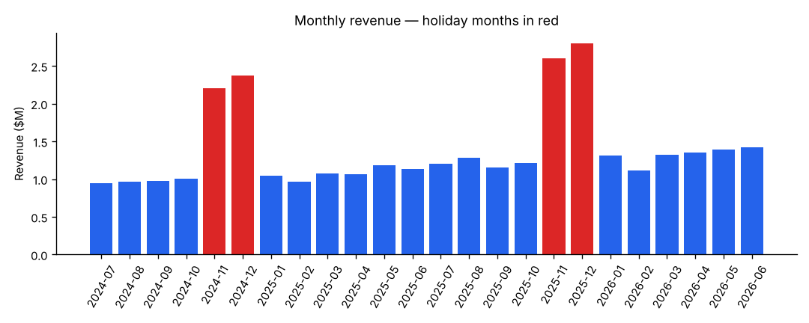
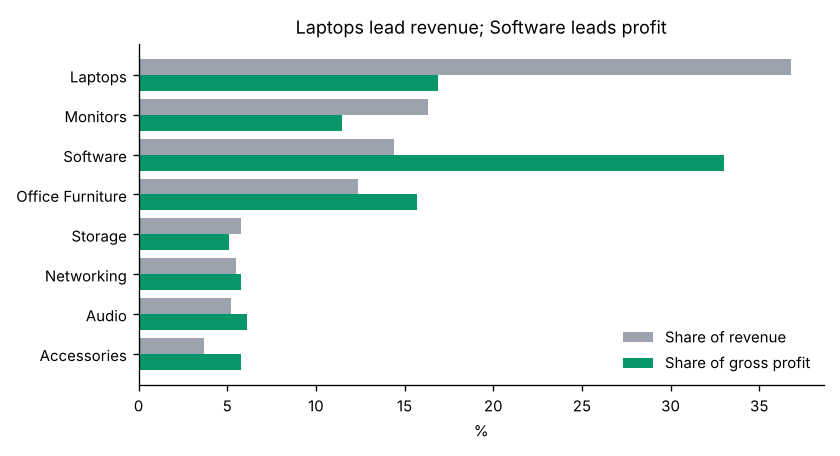
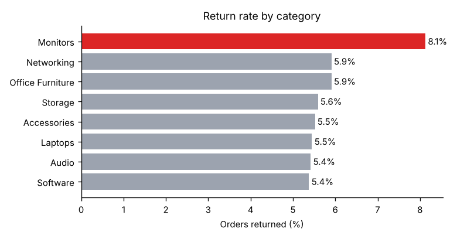
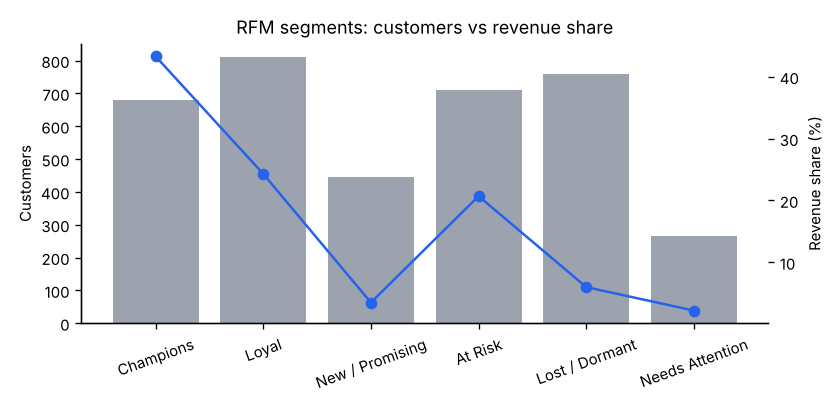

# Retail Sales Analytics in SQL (PostgreSQL)


Fourteen business questions for a multi-channel electronics retailer, answered entirely in PostgreSQL.
The project covers the full SQL workflow: schema design with constraints, a single governed revenue definition,
analytical queries (CTEs, window functions, cohorts, RFM, basket analysis), reusable functions and procedures,
data-quality checks, and BI-ready extracts for Power BI or Tableau.

> **Data note:** the database is seeded with synthetic data generated in pure SQL (`sql/02_seed_data.sql`, using
> `setseed` so every run is identical): 4,000 customers, 12 stores, 64 products, ~44k orders and ~92k order lines
> across two fiscal years (Jul 2024 – Jun 2026).



## Key findings

| Question | Answer |
|---|---|
| Growth | FY2026 revenue **$18.2M, up 21.5%** on FY2025 ($14.9M); margin steady at ~35% |
| Revenue vs profit | Laptops bring **37% of revenue but only 17% of gross profit** (16% margin); Software brings **33% of profit** from 14% of revenue |
| Customer concentration | The **top 20% of customers generate 52%** of revenue |
| RFM | "Champions" (19% of customers) drive 43% of revenue; **"At Risk" customers hold 21% of revenue** and haven't ordered in ~4 months |
| Returns | **Monitors are returned at 8.1%** vs 5.4–5.9% for every other category; worth a quality investigation |
| Holiday discounts | Nov–Dec discounts (avg 9%) cut margin from 35.8% to 32.3% but **roughly double monthly profit** |
| Cross-sell | Laptops + Software is the strongest category pairing (lift 1.11) |
| Customer base | **Returning customers generate 91–93% of revenue** every quarter since Q1 2025, so retention matters more than acquisition |
| Purchase frequency | Over 90% of customers buy again; the median gap between orders is about 3–4 weeks in every segment |

Full results for all 14 questions, each with its SQL, are in **[docs/RESULTS.md](docs/RESULTS.md)**.

| | |
|---|---|
|  |  |



## SQL techniques shown

| Technique | Where |
|---|---|
| Schema design: PKs, FKs, `CHECK` constraints, indexes | `01_schema.sql` |
| One governed revenue/profit definition in a view (`v_sales`) | `01_schema.sql` |
| CTEs, `CASE`, `FILTER (WHERE …)` conditional aggregation | throughout |
| Window functions: `LAG`, `RANK`, `ROW_NUMBER`, `NTILE`, running `SUM`, `ROWS BETWEEN` moving average | q01, q03–q07, q12 |
| Top-N per group | q04 |
| Cohort retention pivot | q08 |
| RFM customer segmentation | q07, `mv_customer_rfm` |
| Market-basket analysis (self-join, support, lift) | q09 |
| `generate_series` to fill missing dates | q12, seed data |
| Time between purchases with `LAG()` and a `PERCENTILE_CONT` median | q13 |
| New vs returning customer revenue with conditional `SUM … FILTER` | q14 |
| PL/pgSQL function with parameter validation | `fn_sales_summary()` |
| Stored procedure + materialized view with concurrent refresh | `sp_refresh_reporting()` |
| Data-quality view (empty = healthy) | `v_data_quality_issues` |

```sql
-- Examples
SELECT * FROM retail.fn_sales_summary('2026-01-01', '2026-03-31', 'region');
CALL retail.sp_refresh_reporting();
SELECT * FROM retail.v_data_quality_issues;   -- 0 rows
```

## Data model

```
regions ─┬─< stores ───────────┐
         └─< customers ──< orders ──< order_items >── products >── categories
                                │
                         v_sales (completed orders, net revenue, cost, gross profit)
```

Column-level definitions, constraints and business rules are in [`docs/data_dictionary.md`](docs/data_dictionary.md).

## How to run

**Option A – Docker** (creates and seeds the database automatically):
```bash
docker compose up -d
pip install -r requirements.txt
python scripts/run_analysis.py            # writes docs/RESULTS.md, charts, and exports/
```

**Option B – existing PostgreSQL 13+:**
```bash
createdb retail_demo
export PGHOST=localhost PGUSER=postgres PGPASSWORD=... PGDATABASE=retail_demo
python scripts/run_analysis.py --setup    # builds schema + data, then analyses
# or run the files directly in psql / pgAdmin / DBeaver, in order 01 → 02 → 04 → 03
```

## Automated checks

On every push, GitHub Actions starts a fresh PostgreSQL 16 database, builds the schema, loads the seed data, runs all
14 queries, confirms `v_data_quality_issues` is empty, and checks that the results still match
[`docs/RESULTS.md`](docs/RESULTS.md).

## Power BI / Tableau

`exports/` contains a star-schema extract (`fact_sales.csv`, `dim_products.csv`, `dim_stores.csv`, `customer_rfm.csv`)
ready to load into Power BI or Tableau. You can also connect the BI tool straight to PostgreSQL and use `retail.v_sales`
so dashboards share the same revenue definition as the SQL.

## Project structure

```
retail-sales-sql-analytics/
├── sql/
│   ├── 01_schema.sql
│   ├── 02_seed_data.sql
│   ├── 03_analysis_queries.sql      # the 14 business questions
│   └── 04_functions_and_views.sql
├── scripts/run_analysis.py           # runs everything, documents results
├── docs/RESULTS.md                   # every question + SQL + result
├── docs/figures/
├── exports/                          # BI-ready CSVs
└── docker-compose.yml
```

## Tools
PostgreSQL 16 · SQL · PL/pgSQL · Python (pandas, psycopg2, Matplotlib) · Docker
